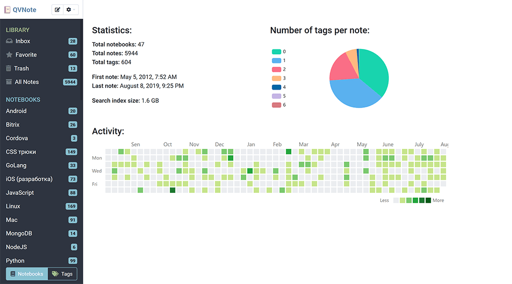

    

# QVNote

A lightweight, self-hosted application for storing notes, web pages, a personal knowledge base, and any other text data.

Runs as a **single portable binary** — a lightweight HTTP server with a browser-based UI, no desktop GUI dependencies. User interface in **English and Russian**.

All data is stored as plain files in a **JSON-based, human-readable format** — easy to back up, move, or process with external tools.

Written with **Go** and **Vue 3**.



## Features

- **Browser-based UI** — works locally or on a remote server, nothing to install on client machines
- **Notebooks, tags, and favorites** — organize notes your way
- **Full-text search** — instant search across all notes, with Russian language support (stemming and stop words)
- **Web page import** — save articles from the internet: the page is fetched and cleaned automatically, keeping only the content
- **Rich-text editor** — WYSIWYG editing with tables, images, and formatting; dedicated code notes with syntax highlighting
- **Automatic image localization** — external images are downloaded into the note on save and served in lossless WebP
- **English/Russian interface** — switchable in settings
- **Single binary, zero dependencies** — download and run; data directory contains only plain files

## Quick start

1. Download the archive with the program for your platform from the [releases page](https://github.com/NightMan-1/QVNote/releases/latest)
2. Unzip the archive and run the binary:

```bash
./qvnote
```

3. Open http://localhost:8000 in your browser and create your first note

> The program runs a local server. You can access your notes by opening http://localhost:8000 in any browser on this computer, or from any other device on the network via this computer's IP address, e.g. http://192.168.x.x:8000

> **Linux security note.** Go 1.24+ enables MPTCP on TCP listeners by default, and kernels without the fix for [CVE-2026-98432](https://security-tracker.debian.org/tracker/CVE-2026-98432) (upstream 7.3-rc7, Debian trixie 6.12.113) are vulnerable to a remote use-after-free in TCP/IPv4. Until your distribution ships a patched kernel, keep the listener off the affected path:
>
> ```bash
> GODEBUG=multipathtcp=0 ./qvnote
> ```
>
> `sysctl -w net.mptcp.enabled=0` also works, but note that it does not affect network namespaces of containers.

## Build from source

#### Requirements

Go >= 1.27  
NodeJS >= 22.x

Frontend stack: **Vue 3**, **Vite**, **Pinia**, **vue-i18n**, **HugeRTE**.

#### Project setup

```bash
git clone https://github.com/NightMan-1/QVNote
cd QVNote
npm install
```

#### Compile for production

```bash
npm run build
go build
```

Now you can run the QVNote binary.

#### Development

```bash
./qvnote                   # backend on :8000
npm run serve              # frontend dev on :8080 (proxies /api to :8000)
```

Open http://localhost:8080

## Command line parameters

```
--help
    usage info
--port=8000
    listen port
--datadir
    data folder, default $HOME/.config/QVNote
```

Optional configuration file: `config.ini` (same keys as CLI flags; CLI flags take precedence).

## Documentation

Full documentation, usage manual, and API reference: https://qvnote.fsky.info/
